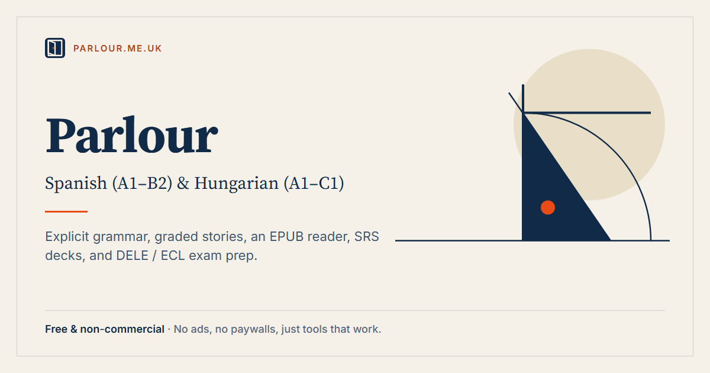

<p align="center">
  <a href="https://parlour.me.uk">
    
  </a>
</p>

# Parlour

*Read, practise, and learn a language.*

No owl. No streak guilt. No paywalled hearts. **Parlour** is a free, non-commercial language-learning web app for self-directed adults who want real CEFR progress—built around explicit grammar, graded stories, an interactive EPUB reader, spaced repetition, and official-format exam prep.

**[Open Parlour → parlour.me.uk](https://parlour.me.uk)**

---

## What's Inside

- **Structured A1–C1 lessons** — Short, focused units with clear grammar paradigms (tables, never buried in prose), progressive exercises, and review consolidations.
- **Library & EPUB reader** — Graded unit stories, adapted classics, and a reader that lets you paste your own texts or import EPUBs, analyses vocabulary coverage, and translates words on tap.
- **Workshop & production practice** — Dedicated drillers for verb conjugations, Hungarian suffixes, listening, written exchanges, and guided speaking scenarios that push past phrasebook sentences.
- **Learner model & SM-2 decks** — Every exercise carries `category` and `teaches` metadata so weak grammar skills resurface automatically alongside SM-2 spaced-repetition vocabulary decks.
- **CEFR & citizenship exam prep** — Placement diagnostics and mock exams aligned with **DELE**, **ECL**, **CCSE**, and the **Hungarian Cultural Exam**.

## Courses at a Glance

| Course | Track | Levels | Units | Lessons | Stories | Exam Alignment |
|---|---|---:|---:|---:|---:|---|
| **Spanish (Latin America)** | `es-latam` | A1–C1 | 242 | 1,452 | 649 | DELE, CCSE |
| **Spanish (Spain)** | `es-es` | A1–C1 | 207 | 1,242 | 434 | DELE, CCSE |
| **Hungarian** | `hu` | A1–C1 | 299 | 1,793 | 846 | ECL, Hungarian Cultural Exam |

## Philosophy

- **Pedagogy first.** Technology serves education, not engagement metrics.
- **Calm over compulsion.** A quiet, editorial interface—cream paper, ink navy, and zero gamified anxiety.
- **Engine / content separation.** One reusable engine; every language is a schema-validated JSON content pack under `content/<lang>/`.
- **No frameworks.** Plain HTML, CSS, vanilla JavaScript, and JSON—shipped as a static PWA.
- **Reuse external resources.** Built on established dictionaries, conjugations, and frequency lists rather than reinventing them (see [`CREDITS.md`](CREDITS.md)).

## Quick Start

Parlour loads its curriculum over `fetch`, so serve the repo locally rather than opening `index.html` via `file://`:

```bash
# macOS / Linux
python3 scripts/dev-server.py

# Windows (PowerShell)
.\.venv\Scripts\python.exe scripts\dev-server.py
```

Then open `http://localhost:8131`.

## Repository Layout

- `engine/` — Reusable app logic (lesson runner, learner model, SRS, reader, workshop, exam engine).
- `content/<lang>/` — Language packs (lessons, grammar, exercises, vocabulary, stories, tests, schemas).
- `styles/` — Editorial visual system (light & dark themes; see [`DESIGN.md`](DESIGN.md)).
- `scripts/` — Build, validation, and content-audit tools (see [`scripts/README.md`](scripts/README.md)).

## Documentation

| Document | What it covers |
|---|---|
| [`AGENTS.md`](AGENTS.md) | Rules for authoring content and code: validator, exercise metadata, teaching principles, wiring a unit, adding a course |
| [`DESIGN.md`](DESIGN.md), [`PRODUCT.md`](PRODUCT.md) | The visual system (prototype in `docs/overhaul-prototype/`) and product brief |
| [`ROADMAP.md`](ROADMAP.md) | Open and planned work |
| [`ACHIEVED.md`](ACHIEVED.md) | Shipped milestones and archived queue items |
| [`docs/SERVICES.md`](docs/SERVICES.md) | Cloudflare Workers and third-party services (cloud sync, Google Sign-In, TTS/STT, grader, bug reports) |
| [`docs/feature-guidance-copy.md`](docs/feature-guidance-copy.md) | First-week guidance copy |
| [`CREDITS.md`](CREDITS.md) | Data sources and licences |

## Development

One task → one test → one commit. Always keep the app working.

Install the Python validation dependency once per checkout, then validate before committing:

```bash
python3 -m venv .venv
source .venv/bin/activate        # Windows: .\.venv\Scripts\Activate.ps1
pip install -r requirements-dev.txt
python scripts/validate-content.py --changed
```
